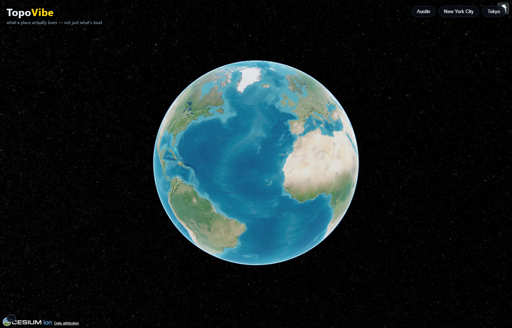
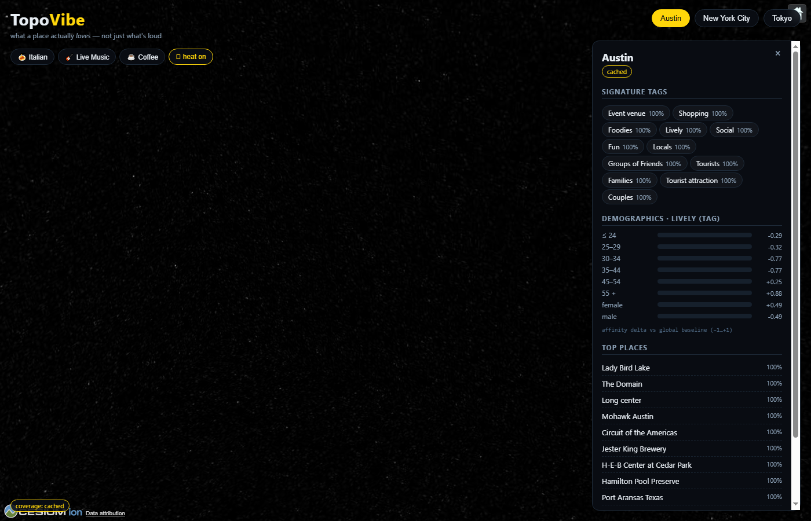
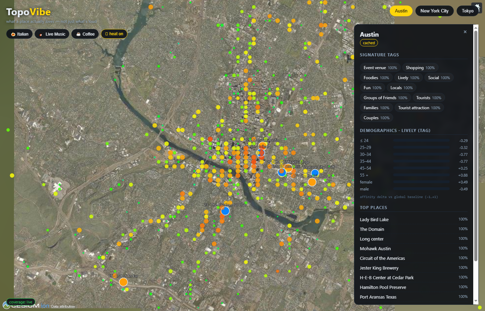

# 🌍 TopoVibe — the cultural-intelligence globe & MCP oracle

> **Fly a 3D globe, click any city, and see what it actually *loves* — every venue scored 0–100 by the Grounding Score, Qloo's taste graph underneath, an MCP server on top so any AI agent can query cultural ground truth.**

**Remove Qloo and TopoVibe is an empty basemap** — cultural intelligence is not a feature, it is the product. TopoVibe runs as a CesiumJS globe for humans and a **first-class MCP server for agents**, answering the hackathon's brief literally: an agentic tool that only works because it knows what people love.

Built for the **Qloo Agentic Hackathon** · MIT License · [Development brief](docs/TopoVibe_Development_Brief.md)

**🌐 Live demo: [topovibe.onrender.com](https://topovibe.onrender.com)** · MCP: `https://topovibe.onrender.com/mcp` (see [`mcp.json`](mcp.json)) · Verified end-to-end with [`scripts/verify-deploy.mjs`](scripts/verify-deploy.mjs) (7/7)







---

## Why TopoVibe

AI agents are culturally blind: they recommend fluent, generic, popularity-ranked "agentic slop." Review sites measure popularity; LLMs hallucinate taste. TopoVibe grounds every answer in **Qloo's taste graph** (250M+ entities, billions of anonymized signals) — the LLM/agent never invents taste, it calls Qloo and narrates verified results. On top of raw answers, TopoVibe computes the **Grounding Score (GS)**, a 0–100 proof-of-human authenticity index, rendered FLIR-style: loved analog venues glow hot red, viral tourist traps glow cold blue.

## The Grounding Score

```
GS(venue) = 100 × clamp(0.6·A + 0.4·T − 0.3·N)
```

| Component | Meaning | How computed (documented Qloo data only) |
| --- | --- | --- |
| **A — Affinity** | How strongly Qloo's graph associates this venue with the cohort | Rank-normalized position in the `/v2/insights` result set (top ≈ 1.0), blended with the venue's `popularity` field |
| **T — Analog density** | Proof-of-human texture | `venue tag-URNs ∩ analog lexicon / lexicon size`. The lexicon (8 keywords: *vinyl, independent bookshop, ceramics, craft, quiet, heritage, record store, third place*) is resolved to real tag URNs via `/v2/tags` at server startup |
| **N — Viral noise** | Tourist-trap penalty | `/v2/trending` acceleration — **but `/v2/trending` does not support `urn:entity:place`** (verified live against the hackathon API), so for venues `N = 0` and `n.unknown = true` (pre-agreed kill-switch, shown in the UI, never hidden) |

GS is **withheld** (`gs: null`, `confidence: insufficient-data`) when affinity results are empty or the lexicon failed to resolve. It is never interpolated. Every panel shows the three component bars — the score shows its work.

## Features (the 7-hour MVP cut)

- **CesiumJS 3D globe** on keyless Esri World Imagery, bundled demo cities (Austin · New York City · Tokyo), no geocoder dependency
- **Cultural DNA panel** — click a city → signature tags, demographics (age + gender affinity deltas), top 10 places
- **Cultural heatmap** — one tag draped over one city as affinity-colored points (blue → red), toggleable
- **Grounding Score markers** — red/amber/blue/grey venue markers; click → A/T/N breakdown panel
- **TopoVibe MCP server** — 5 tools for AI agents over streamable HTTP
- **Share links** — camera + city + tag round-trip through the URL hash
- **Honest data everywhere** — coverage badges (`live | cached | insufficient-data`) on every panel, and the raw Qloo **query echo** behind every taste claim

## Architecture

```
AGENTS (MCP)                         HUMANS (browser)
Claude/Cursor · agent loops          TopoVibe globe (static, Vite + CesiumJS)
        │ HTTP + JSON-RPC (streamable)        │ REST/JSON
┌───────┴─────────────────────────────────────┴────────────┐
│            TopoVibe SERVER (Node.js, Express)             │
│  server/qloo.js       broker: X-Api-Key server-side only, │
│                       GET-only, 6h TTL cache, validity    │
│  server/validity.js   param ↔ filter.type matrix          │
│  server/grounding.js  Grounding Score engine (A/T/N)      │
│  server/routes.js     /api/dna · /api/heatmap ·           │
│                       /api/grounding · /api/resolve ·     │
│                       /api/health                         │
│  server/mcp.js        MCP endpoint: 5 tools               │
│  server/cache.js      TTL cache + demo pre-cache loader   │
└───────┬──────────────────────────────────────────────────┘
        │ GET, query string, X-Api-Key
┌───────┴──────────────────────────────────────────────────┐
│       Qloo API — https://hackathon.api.qloo.com          │
│       /search · /v2/tags · /v2/insights · /v2/trending   │
└──────────────────────────────────────────────────────────┘
```

## Quick start

```bash
git clone <repo-url> && cd topovibe
npm install                      # Windows sandbox note: use --ignore-scripts if esbuild's postinstall is blocked
cp .env.example .env             # paste your Qloo hackathon key into QLOO_API_KEY
npm run selfcheck                # MUST be green before anything else
npm run dev                      # globe at http://localhost:4173 (API proxied)
```

Click **Austin** → DNA panel. Click a preset (🍝 🎸 ☕) → heatmap + GS venue markers. Click a marker → the score shows its work.

### Demo mode (never touches the network)

```bash
npm run precache                 # burn quota once: 3 cities × 3 presets → cache/precache.json (git-ignored)
npm run dev                      # demo flows now serve with coverage=cached
```

### Production

```bash
npm run build                    # Vite build → dist/
npm start                        # Express serves dist/ + API + MCP on PORT (4173)
```

## TopoVibe MCP — the agentic surface

5 tools, streamable HTTP, per-IP rate limit (30/min). Every response embeds the raw Qloo `query` echo for auditability; errors are named and actionable.

| Tool | Args | Returns |
| --- | --- | --- |
| `resolve_entities` | `query, types?` | `[{name, entity_id, subtype, popularity}]` |
| `resolve_tags` | `keyword` | `[{tag_id, name, subtype}]` |
| `get_insights` | `filterType, signals{}, filters{}, take?, page?` | ranked entities (validity-checked against the Qloo matrix) |
| `get_taste_profile` | `locationQuery` | signature tags + demographics + top places |
| `get_grounding_score` | `city, tag` or `city, entityIds[]` | `[{entity, gs, components, confidence}]` |

Wire any MCP client with [`mcp.json`](mcp.json):

```json
{ "mcpServers": { "topovibe": { "type": "streamable-http", "url": "http://localhost:4173/mcp" } } }
```

Inspect interactively: `npx @modelcontextprotocol/inspector` → connect → `http://localhost:4173/mcp`.

## REST API (the only endpoints — no others exist)

| Endpoint | Wraps | Used by |
| --- | --- | --- |
| `GET /api/health` | self-check | boot banner |
| `GET /api/resolve?q=&types=` | `/search` | entity pickers |
| `GET /api/dna?city=` | `urn:tag` + `urn:demographics` + `urn:entity:place` | DNA panel |
| `GET /api/heatmap?city=&tag=` | `urn:heatmap` | heat layer |
| `GET /api/grounding?city=&tag=` | insights + tags + GS engine | GS markers |

## Qloo rules this codebase enforces (and verifies)

1. Base URL is `QLOO_BASE_URL`, default `https://hackathon.api.qloo.com` — startup self-check fails loudly otherwise.
2. Auth is `X-Api-Key` header — never Bearer, never query param. The key lives only in `.env` (git-ignored) and is read from the environment at runtime.
3. `/v2/insights` is GET with query-string params only.
4. `filter.type` values are full URNs; `PLACE`-style shorthand is rejected with a named error.
5. IDs are resolved before signaling (`/search`, `/v2/tags`) — never invented.
6. Location modes: `signal.location.query`, `signal.location`, `filter.location.query`, `filter.location.radius`.
7. The validity matrix (`server/validity.js`) strips + logs invalid params client-side — the API ignores them silently, we refuse to.
8. Legacy `/recs` and `/recommendations` throw `QlooForbiddenEndpoint` without a network call.

### Verified-against-live-API notes (things the docs don't tell you)

- `/v2/tags` requires `filter.query` (a bare `?query=` 400s with a helpful error listing valid filters).
- `/v2/trending` `filter.type` accepts only `actor, artist, brand, movie, person, podcast, tv_show` — **not** `urn:entity:place` (hence `n.unknown` for venues).
- `filter.location.query` hard-filters places to a locality; `signal.location.query` alone can drift out-of-town (an Austin record-store query leaks San Antonio venues).
- Demographics coverage is sparse: niche tags return empty; the DNA panel falls back through top tags → top places and says `insufficient-data` honestly when all fail.
- The indie-music *keyword* tag yields no place heat grid; demo presets use place-genre tags (verified dense in all three demo cities).

## Honest-data & ethics rules (enforced in code review)

1. No taste claim without a Qloo `query` echo behind it.
2. GS withheld, never interpolated, on insufficient data.
3. People are not a query type — no person-tracking affordances.
4. No PII collected; no accounts.
5. Coverage badge on every panel: `live | cached | insufficient-data`.

## Deployment

One service serves everything (static client + REST + MCP) — so one host covers the whole app:

- **Render free instance** (used for this submission) — [`render.yaml`](render.yaml) Blueprint: Render → New → Blueprint Instance → repo `kvmtest/topovibe` → set `QLOO_API_KEY` when prompted → Deploy. Render injects `PORT` itself; the service listens on it. Free instances sleep after ~15 min idle — point a free uptime ping (e.g. UptimeRobot, 5-min interval) at `/api/health` to keep it warm for judges. Manual alternative: New → Web Service → build `npm install && npm run build` → start `npm start`.
- **AWS Elastic Beanstalk** (planned for the final version) — upload a source bundle (`git archive` of tracked files — no secrets, no cache), Node.js 22 platform, set env var `QLOO_API_KEY`. EB runs `npm install` and `npm start`, which auto-builds the client on first boot ([`scripts/start.mjs`](scripts/start.mjs)).
- **AWS App Runner** — [`apprunner.yaml`](apprunner.yaml) included, but note: App Runner stopped accepting new customers (AWS notice, April 30, 2026); existing-customer accounts can still use it.
- **Fly.io** — `fly launch` (Node 20+, port 4173), `fly secrets set QLOO_API_KEY=...`.

After deploying, point `mcp.json` at `https://<your-host>/mcp`.

## Kill-switches engaged during the build (brief §9 — honest list)

| Kill-switch | Status |
| --- | --- |
| MCP SDK trouble → plain REST | **Not needed** — `@modelcontextprotocol/sdk` streamable HTTP works; verified headlessly via raw JSON-RPC (initialize → tools/list → 5 tools/call → 429 rate limit). |
| Sparse trending → `N=0` + `unknown` flag | **ENGAGED** — `/v2/trending` has no `urn:entity:place` support; every venue shows `n.unknown = true`. |
| Sparse heatmap city → backup city | **Not needed** — Austin/NYC/Tokyo grids are dense for all 3 presets. Two *tags* were swapped instead (indie-music keyword → live-music-venue; specialty-coffee → coffee-shop genre). |
| Deploy trouble → flawless local run | Available; `npm start` after `npm run build` is the judged fallback. |

## Repo layout

```
topovibe/
├── LICENSE                     # MIT + attribution note
├── README.md · mcp.json · render.yaml
├── .env.example                # QLOO_API_KEY, QLOO_BASE_URL, PORT, DEMO_CITIES
├── package.json · vite.config.js · index.html
├── src/                        # CLIENT (Vanilla JS + CesiumJS + Vite)
│   ├── main.js                 # boot: viewer, basemap, wire modules
│   ├── globe.js                # Cesium init (Esri), fly-to
│   ├── cities.js               # bundled demo-city list (keyless search)
│   ├── layers/insights.js      # GS-colored venue markers
│   ├── layers/heatmap.js       # urn:heatmap → affinity-colored points
│   ├── panels/dna.js           # Cultural DNA panel
│   ├── panels/grounding.js     # GS badge + A/T/N bars
│   └── share.js                # scene ⇄ URL hash
├── server/
│   ├── index.js                # Express boot, static, startup self-check
│   ├── qloo.js                 # broker (X-Api-Key, GET-only, cache, validity)
│   ├── validity.js             # param ↔ filter.type matrix
│   ├── grounding.js            # Grounding Score engine
│   ├── routes.js               # /api/* REST (+ shared builders for MCP)
│   ├── mcp.js                  # MCP server (streamable HTTP), 5 tools
│   └── cache.js                # TTL cache + demo pre-cache loader
└── scripts/
    ├── selfcheck.mjs           # one /v2/insights ping — green at minute 0
    ├── precache.mjs            # warms cache for 3 demo cities × 3 presets
    ├── probe.mjs / probe-raw.mjs / probe-entity.mjs   # API shape discovery
    └── phase1/4/5-check.mjs    # acceptance checks
```

## Attribution & legal

- TopoVibe is a **clean-room build**, inspired by the open-source "God's Eye View" project (MIT) — no God's Eye View code, assets, or data were copied.
- **Qloo**: hackathon key, valid only on `hackathon.api.qloo.com`, subject to rate/monthly quotas, expires post-judging. Responses are cached privately per Qloo terms; nothing cached is committed (`cache/` is git-ignored). Production use requires a commercial Qloo agreement.
- **Basemap**: Esri World Imagery per Esri terms; attribution rendered on-globe.
- Demo geography: Austin · New York City · Tokyo (the cities Qloo's own docs use in examples).

## License

MIT — see [LICENSE](LICENSE).
